Checks for technical problems in FCS files and batches. Every function returns
numbers. None marks a file or batch as bad, and none has a default for a value
that changes a result (a cutoff, a count of events, a seed, a scale). You choose
those, because a different choice flags different files.

## What each function covers

| Problem | Function | What it reports |
|---|---|---|
| Header differs from a reference (voltage, instrument, channel names) | `sw_fcs_header_audit()` | one row per file and compared item, with a status |
| Saturation, dead channel, non-finite values, negative share | `sw_fcs_signal_audit()` | share or flag per file and channel |
| Event-rate instability, clog, gaps in time | `sw_fcs_signal_audit()` | `rate_cv`, `max_gap` |
| Drift of a marker inside one file | `sw_fcs_signal_audit()` | `time_trend` per channel |
| One marker shifted, stretched or split in a file | `sw_fcs_signal_audit()` | `median_z`, `sd_z`, `bimodality_z` per channel |
| A fault most files share | `sw_signal_reference_fit()` + `sw_fcs_signal_audit(reference = )` | `median_z`, `sd_z` against a frozen reference |
| Wrong spillover or unmixing (channel-pair correlation) | `sw_fcs_signal_audit()` | `corr_shift` and the pair |
| Change in a rare population, or in a file's composition | `sw_cluster_scores()` | `freq_z`, `median_z` per cluster |
| File unlike the other files | `sw_anomaly_features()` + `sw_anomaly_flag_outlier()` | forest score per file |
| File unlike a reference set | `sw_anomaly_features()` + `sw_anomaly_flag_novelty()` | log-density per file |
| Batch effect per marker | `sw_batch_scores()` | pairwise EMD, batch-vs-rest EMD and its z, median range, eta2, spread ratio, order drift |
| Signal stability over time | `sw_qc_run()`, `sw_qc_plot()`, `sw_qc_heatmap()` | PeacoQC result, plot, heatmap |
| All of the above in one table | `sw_diagnose()`, `sw_diagnosis_top()` | stacked table; top values per check |
| Browse the result | `sw_qc_app()` | Shiny explorer |
| CytoScan itself | `sw_cytoscan_run()`, `sw_cytotools_header()` | wrappers (GPL, from Suggests) |

## One call

```r
dx <- sw_diagnose(
  data = files, # named list of per-file matrices, already on your analysis scale
  header = NULL,
  signal = list(
    channels = chans, range_max = 4e6, range_min = NULL,
    time_channel = "Time", time_bin = 5,
    area_height = c(`FSC-A` = "FSC-H"), area_height_quantile = 0.99,
    reference_group = NULL, # or a named vector file -> donor, to score within donor
    reference = NULL # or a frozen reference from sw_signal_reference_fit()
  ),
  anomaly = list(
    channels = chans, features = c("quantile", "emd"), quantile_step = 0.1,
    n_events = 500, seed = 1, scale = "arcsinh, cofactor 6000",
    aggregate_from = "all", agg_size = 5000, reference = NULL, reference_group = NULL,
    ntrees = 300, sample_size = 32, ndim = 1
  ),
  batch = list(
    batch = batch, markers = chans, n_events = 500, seed = 1, order = NULL,
    reference_group = NULL
  ),
  cluster = list(
    markers = chans, k = 6, n_events = 500, seed = 1, nstart = 3,
    min_cluster_events = 30, reference = NULL, reference_group = NULL
  ),
  relativise = NULL, # or list(model = <sw_relativise_fit() result>, batch = ..., order = ...)
  otd = list(
    markers = chans, n_events = 1000, reference_events = 10000, blur = 0.75,
    seed = 1, max_iter = 500, tol = 1e-5
  ),
  negative = list(channels = chans, n_events = 2000, seed = 1, hyper_k = 4, pairs = "all",
    spread_quantile = 0.95, min_separation = 3),
  gate = NULL
)
sw_diagnosis_top(dx, n = 5)
shiny::runApp(sw_qc_app(dx, n = 15, qc_report = NULL))
```

The numbers above are illustrative. They are not recommended values.

## Coverage at a glance

One row per fault class: the check that finds it best, its AUROC in simulation
and, where tested, on real Aurora files with the fault injected. AUROC ranks
faulty files (or, for batch faults, the hit marker among 40) above clean ones;
0.5 is chance. Sizes are the ones tested, not guarantees. Sections below give
the figures behind each number. Faults marked "not tested" on real files have
no real-file evidence yet.

| Fault class | Best check | Simulation | Real files (injected) |
|---|---|---|---|
| Header / keyword mismatch | `sw_fcs_header_audit()` | exact by construction | real, not injected: all 9 Fortessa files flagged on `$CYT`, `$PnR` and `$PnV` (15 channels); 4 Aurora files flagged on `$PnV` and `$DATE` (a later session) |
| Saturation | `saturation_share` | 1.00 | 1.00 (5% of events at the channel maximum) |
| Dead channel | `zero_variance` | 1.00 | 1.00 |
| Missing or infinite values | `nonfinite_share` | 1.00 | 1.00 (2% of events) |
| Clog / event-rate drop | `rate_cv` | 1.00 | 1.00 (80% drop over 30% of the run) |
| Drift within a file | `time_trend` | 1.00 | 1.00 (1 SD over the run) |
| Debris spike | `corr_shift` | 1.00 | 1.00 (10% of events) |
| Doublets | `area_height_z` (`FSC-A / FSC-H`) | unit test | 1.00 at 2% with quantile 0.99; 0.99 at 5% with 0.95 (72 CytoBatchFlagR files) |
| Spillover between two channels | `corr_pair_z` (per pair row) | 1.00 (`corr_shift`) | 0.99 at slope 0.3 (`corr_shift` 0.66; the max over pairs 0.62) |
| One-marker shift | `median_z` | 0.99 at 0.5 SD; ~0.6 at 0.2 SD | 0.95 at 1 SD, 0.82 at 0.3 SD (hit marker's row) |
| One-marker stretch | `sd_z` | 1.00 at x1.2; 0.57 at x1.05 | 0.94 at x1.5, 0.80 at x1.3 (hit marker's row) |
| All markers widened | `global_sd_z` (file level) | 1.00 (`sd_z`) | 0.88 at x1.2, 0.82 at x1.1 (one marker's `sd_z`: 0.86, 0.61); just below the bar |
| Split into two modes (one marker) | `emd_z` (anomaly module) | **0.67 (`corr_shift`, weak); `bimodality_z` 0.58** | limit ±1 SD: 0.93 (`sd_z` 0.90); ±1.5 SD ≥ 0.99; ±0.5 SD 0.70, below the bar; `bimodality_z` 1.00 at ±0.5 SD only on markers that are already bimodal |
| Change in a rare population | `median_z` (cluster module), the cluster's own row | 1.00 at 20% of events; 0.95 at 10%; 0.49 at 2% | 0.95 at +1 SD, 0.96 at +2 SD on the hit cluster's row (max over clusters: 0.88, 0.84) |
| Composition change | `freq_z` (cluster module), the cluster's own row | 1.00 | 80% of the largest cluster (31%) removed: 1.00; 50%: 0.82; 80% of the smallest (7%): 0.81 |
| Negative population shifted | `neg_median_z` | 1.00 at 0.3 SD | 1.00 at 1 SD, 0.84 at 0.3 SD |
| Negative population widened | `neg_sd_z` | 1.00 at x1.5, 0.96 at x1.2 | 1.00 at x1.5 |
| Hyper-negative events | `hyper_negative_share` | 1.00 at 1% | 1.00 at 3% |
| Angled negative | `neg_corr_z` | 1.00 at slope 0.3 | 0.93 at slope 0.3 |
| Spillover spread into a negative | `spread_z` (negative audit, per directed pair) | unit test | 0.98 at 1 negative SD with quantile 0.95; 0.76 at 0.5 SD; real Glehr instruments: no source spreads more on the Fortessa |
| Leak into a negative channel | `spill_corr_z` (+ `neg_median_z` if it shifts) | 0.96 at 15% | 0.94 at 15%, 0.68 at 5% |
| Batch shift (one marker) | `pair_emd` | 1.00 | 0.92 at 0.5 SD, 0.75 at 0.25 SD |
| Batch stretch (one marker) | `spread_ratio` / `pair_emd` | 1.00 | 0.87 at x1.3 |
| Batch split into two modes | `spread_ratio` | **0.86 (weak, seeds 0.57 to 1.0)** | 0.99 at ±1 SD; ±0.5 SD best `pair_emd` 0.78, below the bar |
| Drift across a batch | `order_rho` / `pair_emd` | 1.00 | 0.86 at 0.5 SD |
| Instrument offset and gain per batch | `sw_relativise_diagnose()` gain | gain recovered (cor 0.93 to 1.00) | real, not injected: same 9 donors on Aurora and Fortessa; Aurora gains 2.0 to 2.4x the cohort median, Fortessa 0.06 to 0.39x |
| Instrument batch per marker | `eta2` | see batch rows | real, two studies: median 0.88 / 0.82 before CD3 relativisation, 0.07 / 0.017 after; AF700 and PB keep 0.5 to 0.9 in both |
| Gate misplaced or failed transfer | `sw_gate_qc()` `kept_share`, `centroid_shift` | unit tests | real: density gate F1 0.999 (FORT), 0.955-0.969 (BAD); failed shift-only transfer keeps 100% of events (F1 0.31) |
| Batch effect, biology fixed | `eta2` | see batch rows | real: same 4 controls in 18 batches; eta2 0.22 to 0.95 per marker |
| Instrument gain drift over dates | `gain_order_rho` (relativise) | see relativisation | real: CD3 gain rho -0.52 over two years; one batch-wide jump |
| Weak CD3 anchor in a control | `separation` (relativise) | 1 test case | real: Fortessa KrO-A 1.13 to 1.21, others 2.2 to 3.2; only KrO-A's M is off (up to 0.28 log) |

Real-file numbers come from one Aurora dataset (36 to 144 donor files, 40
markers, OMIQ-transformed). The negative-population numbers cover only the 10
of 40 channels whose mixture split cleanly. The batch numbers sit on top of
real batch differences that are confounded with donor.


## How well each check finds a fault (simulation)

The benchmark in `experiments/benchmarks/07_fault-detection/` injects one fault
class at a time into simulated cohorts (72 files, 8 markers, 12 faulty files or
one faulty batch of 4) and scores each check by AUROC over 10 seeds. Values below
are from simulated data with effect sizes I chose; they say how a check ranks a
fault of that size, not how it will do on your cohort.


- Fifteen of the 17 fault classes have a check with mean AUROC of 0.98 or
  higher (figure: `figures/fault-detection-matrix.png`). One check per class is
  not enough to name a cause: `median_z`, `sd_z` and the cluster checks also
  respond to saturation, drift and dead channels.
- A shift confined to the rarest population (20% of events) is found by
  `cluster_median_z` (AUROC 1.00) and, in this simulation, by `sd_z` (0.99); the
  forest scores 0.63. A composition change is found by `cluster_freq_z` (1.00).
  The cluster checks need `k`, which you choose, and were run with k = 6 here.
- A symmetric split into two modes in a single marker is the weak case:
  best AUROC 0.67 (+/- 0.07) in a file and 0.86 (+/- 0.11, seeds from 0.57 to
  1.0) for a batch. In this mixture the split changes the SD by about 4%, which
  is below the file-to-file jitter.
- With labels shuffled, every check scores 0.50 to 0.54, so the benchmark does
  not reward noise.

## How small a fault can be (simulation)

`experiments/benchmarks/08_detection-limits/` puts one fault of a given size into
12 of 72 simulated files and scores four checks over 6 seeds.


- A one-marker shift is found well at 0.5 SD (`median_z` 0.99) and is near chance
  at 0.2 SD or less. A one-marker stretch is found at x1.2 (`sd_z` 1.00) and not at
  x1.05 (0.57). A 1 SD shift in a rare population is found when it holds 10% of
  events (`cluster_median_z` 0.95), not at 5% (0.59) or 2% (0.49)
  (figure: `figures/detection-limits.png`).
- Changing `k` (3, 6, 12) or the number of faulty files (4, 12, 24) moved these
  limits little; effect size sets them.

## On real files: rank markers, not files

Faults were injected into 36 real Aurora donor files of one batch (40 markers,
OMIQ-transformed; 25% of files faulty, 10 seeds). The z-score of the hit marker
finds a 1 SD shift at AUROC 0.95 and a x1.5 stretch at 0.94. Taking the largest
|z| over all 40 markers per file drops these to 0.74 and 0.69
(figure: `figures/real-injected-marker-level.png`). The hit-marker score knows
which marker was hit, so it is an upper bound. Files differed little in these
data: the SD of file medians was 0.10 of the pooled marker SD.


So `sw_diagnose()` keeps one row per file and marker, and `sw_diagnosis_top()`
ranks within each check and marker. There is no per-file summary score; that
was decided on 2026-11-09.

Two fault classes need a larger fault on real files than in simulation,
because real donors already differ in shape. A marker split into two modes
reaches AUROC 0.90 at ±1 SD (`emd_z` 0.93, `sd_z` 0.90). A shift inside the
smallest of 6 clusters reaches it at +3 SD when the largest |z| over all
clusters is used (+1 and +2 SD: 0.88 and 0.84, wide intervals).


`bimodality_z` (the bimodality coefficient per file and channel, as a robust z
over files) does not close the split gap. In simulation, where each population
has SD 1, a ±0.5 split stays one peak: it scores 0.58, and a Hartigan dip
score, tried as the fallback, 0.51 (`figures/bimodal_sim_tools.png`). On real
files it scores 1.00 at ±0.5 SD, 0.65 at ±1 SD and 0.85 at ±1.5 SD, the dip
0.85, 0.82 and 0.78 (`figures/bimodal_limits_real.png`). The score does not rise
with size because each seed hits another marker: most real markers already
have two populations, the split blurs them and the coefficient drops, so it is
found there; on markers with one population it is not. Read `bimodality_z` as
a check for markers with two populations, not as a general split detector. The
dip is not in the package.

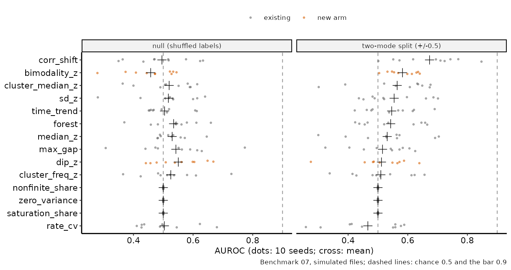

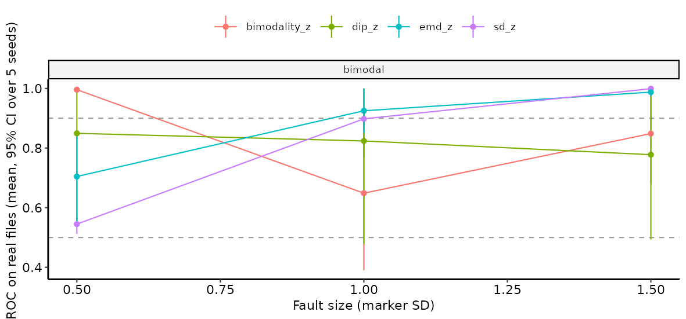

The rare-population loss came from that maximum over clusters, not from the
clustering. Read on the found cluster nearest the injected one, the same
check scores 0.95 at +1 SD and 0.96 at +2 SD, as good as scoring the injected
cluster directly (0.96). Fitting the clusters on clean files only did not
help (0.86). So `sw_diagnose()` ranks each marker and cluster as its own item
("CD3 / cluster 2").

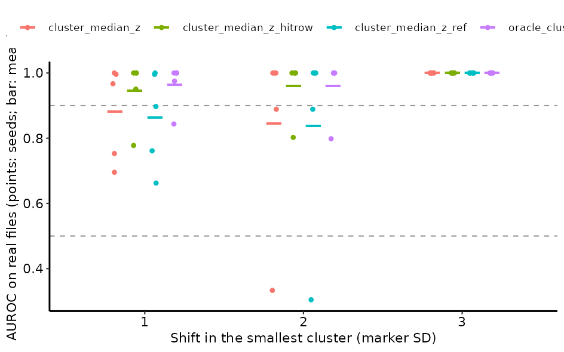

The same holds for composition. Removing 80% of the smallest cluster (7% of
events) scores 0.81 on that cluster's own `freq_z` row and 0.54 as a maximum
over clusters. Removing 80% of the largest cluster scores 1.00. Widening every
marker by x1.2 reaches only 0.86 on one marker's `sd_z`.

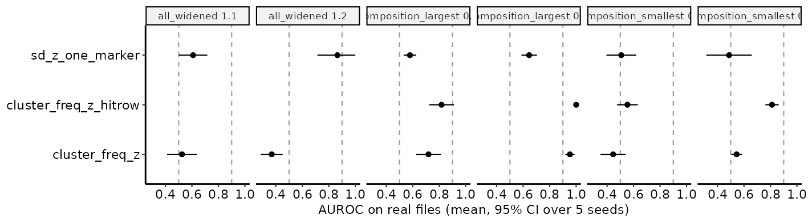

## Faults that live only in the negative population

`sw_negative_audit()` finds each channel's negative population with a
two-component Gaussian mixture and checks its centre, width, events far below
it, and its correlation with another channel's negative. These symptoms come
from O. Burton's Colibri Cytometry posts on unmixing errors.

In simulation (`experiments/benchmarks/10_negative-faults/`, 12 of 72 files
faulty, 5 seeds), each fault is found by its own check: a 0.3 SD shift of the
negative by `neg_median_z` (AUROC 1.00), a x1.5 widening by `neg_sd_z` (1.00),
3% hyper-negative events by `hyper_negative_share` (1.00), and a 0.3 slope
between two negatives by `neg_corr_z` (1.00). The whole-file checks score 0.45
to 0.65 on the same faults, except `sd_z` at 0.94 for hyper-negatives
(figure: `figures/negative-faults-sim.png`).


On 36 real donor files with the same faults injected
(`experiments/integration/aurora_exvivo/06_negative_real.R`), the matching
check scores 0.93 to 1.00 and the whole-file checks 0.43 to 0.70
(figure: `figures/negative-faults-real.png`). A 0.3 SD shift of the negative is
found at 0.84. These real-file numbers cover only the 10 of 40 channels whose
mixture separation was 3 or more; read `separation` before trusting the
negative checks on a channel.

`min_separation` (required) now does that for you. A channel whose median
separation over files is below it keeps its rows, but the negative checks,
their z and every pair check that uses it get `NA` and the reason in `detail`;
`split_ok` says which channels are scored. The gate acts per channel, not per
file, because a widened negative lowers that file's own separation and a
per-file gate would hide the fault. At 3, 10 of 40 Aurora channels are scored
(`figures/negative_gate.png`), and the reruns of 06, 08 and 14 give the same
AUROCs as before, because those benchmarks only inject into those channels.

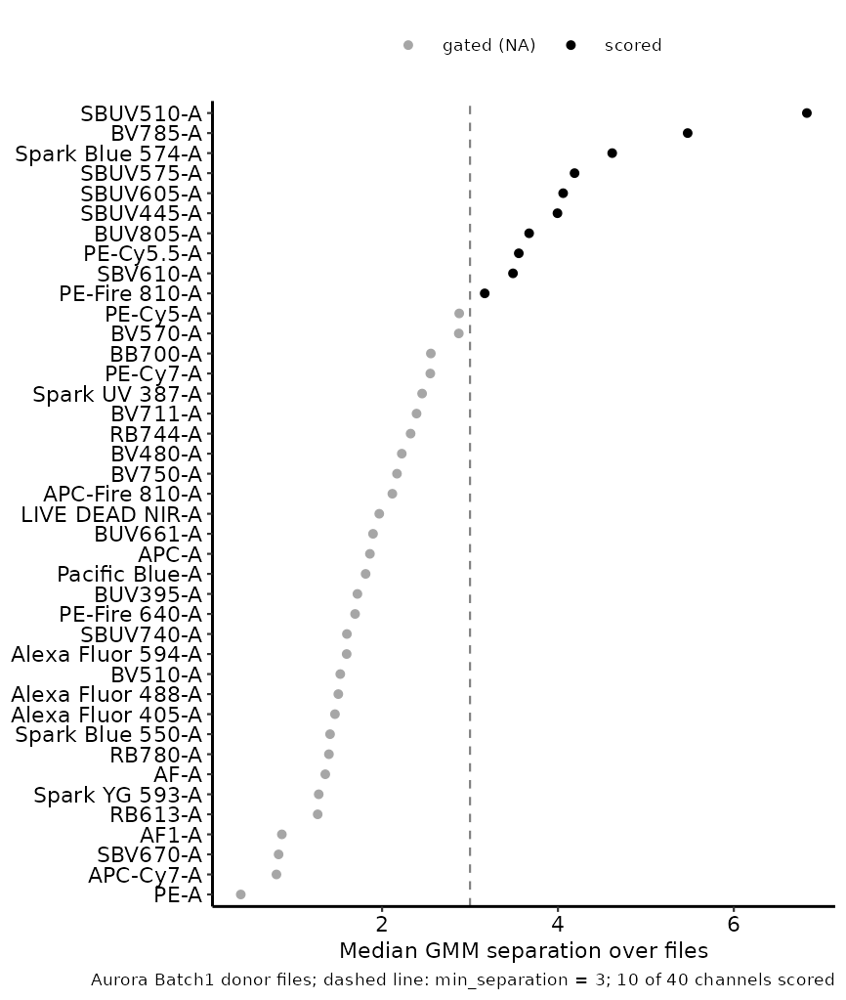


### Leaks into a negative channel

Tandem breakdown and some dye interactions add signal to a channel that should
be negative, in proportion to a bright channel. `spill_corr` (in
`sw_negative_audit()`) is the Spearman correlation of the two channels inside
events that are positive in the source and negative in the target; pass the
pairs you suspect (for example a tandem and its parent) in `pairs`. On 36 real
donor files with a leak injected that adds no net shift, `spill_corr_z` found a
15% leak at AUROC 0.94 and a 5% leak at 0.68, while every other check stayed at
0.49 to 0.67 (figure: `figures/spill-leak-real.png`). In simulation, a leak that
also shifts the negative is found as well by `neg_median_z` and `corr_shift`.


## Is the clustering stable enough to trust the cluster checks?

`sw_cluster_stability()` reruns k-means with several seeds and subsample sizes
and reports the adjusted Rand index and the share of events that change
cluster. On the real Aurora files (500 events from each of 149 files, 5
seeds), k = 6 gave identical partitions, k = 12 moved a median 12% of events
between seeds (up to 21%), and k = 20 moved 29% (up to 43%)
(figure: `figures/cluster-stability-real.png`). Two runs raised k-means
quick-transfer warnings, so part of that may be non-convergence. Check the
stability at your `k` before reading `cluster_median_z` or `cluster_freq_z`.


## A real instrument batch and its CD3 correction

The Glehr et al. (2026) BAD study stained 9 donors once and acquired each
sample on an Aurora and a Fortessa, with a CD3 single-stain control per
channel. The instrument is then a known batch with identical biology. The
scripts are in `experiments/integration/glehr2026/`.

Our relativisation reproduces the authors' own. Their relativised files are
an exact linear map of the originals (R² = 1 on every donor and channel), so
their m and M can be read back. On the Aurora, our m and M from the controls
match theirs on all 9 donors and 10 channels: median |log M ratio| 0.0011,
worst 0.0056.


`eta2` finds the instrument batch, and relativisation removes most of it. The
instrument explains a median 88% of the variance of file medians before
relativisation. After it, the instrument explains 5% (authors) or 7% (ours).
AF700, PB and AA750 keep 35% to 88%, so on those channels CD3 does not anchor
the two instruments alike.


The same holds in the study's second arm, FORT: 14 samples on a Fortessa, an
LX and a Navios. Instrument eta2 falls from a median of 0.82 to 0.013 (authors)
and 0.017 (ours), and our values overlap the authors' on every marker. AF700
and PB again keep 0.76 and 0.51. So in two studies and four instruments, CD3
does not anchor those two channels alike. The authors rescaled scatter and
time in these files, so their events were matched back through a per-file
linear map (all 42 files matched exactly).

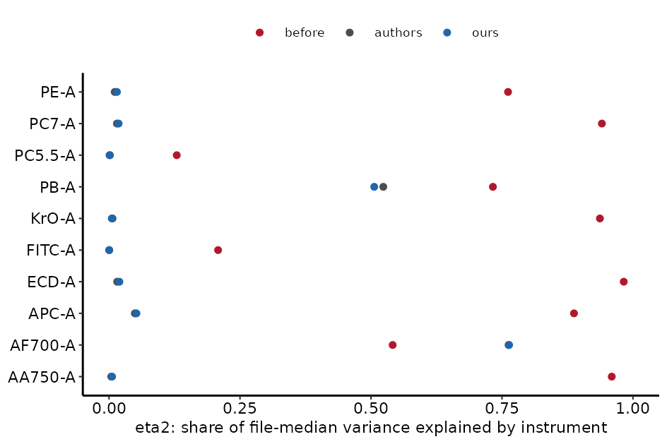

Why AF700 and PB stay. On the BAD files, the authors' relativised AF700 (CD8)
agrees between instruments at the 10th and 90th decile, but its 20th to 50th
deciles sit up to 0.7 higher on the Fortessa (asinh(x / 1000) scale). PB
(CD57) drifts from -0.22 at the 10th decile to +0.12 at the 90th. The CD3
anchor lines up the positive peak, not the lower part.

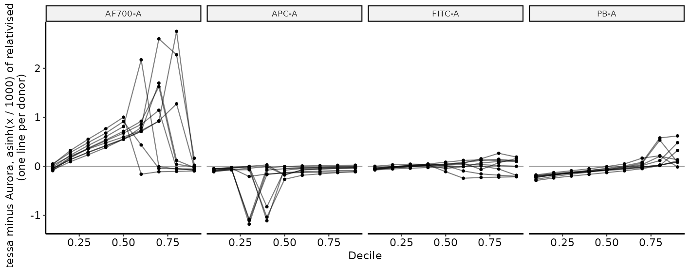

`sw_negative_audit()` names the cause. On the Fortessa the AF700 negative
population sits higher (median 0.08 to 0.50) and is 5.6 times wider (SD 0.09
to 0.53) in every donor; PB's negative is 2.8 times wider and lower. Other
channels widen about 2 times but keep their median. A two-point linear map
from a CD3 single stain cannot correct a negative population that differs in
the full stain.

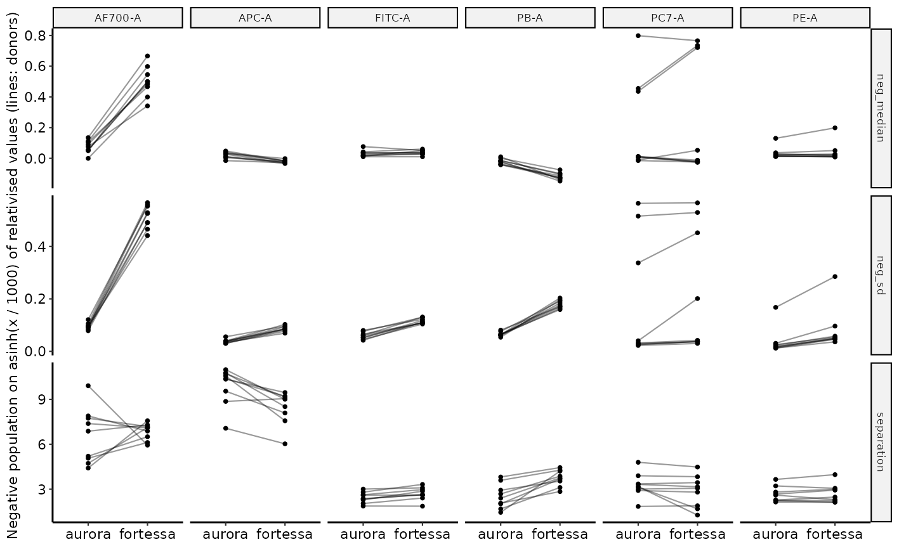

Spillover spread from the other nine dyes does not explain the wider
negatives. `spread_log_ratio` compares the AF700 (or PB) negative's SD where a
source dye is bright with its SD where that dye is dim. On every source it sits
near 1 on both instruments; no source spreads more on the Fortessa (AA750 into
AF700: 1.28 on the Aurora, 1.03 on the Fortessa, quantile 0.9). The widening
is the same at low and high source signal, which fits a wider noise floor in
the Fortessa's AF700 and PB detectors; the next paragraph tests that.

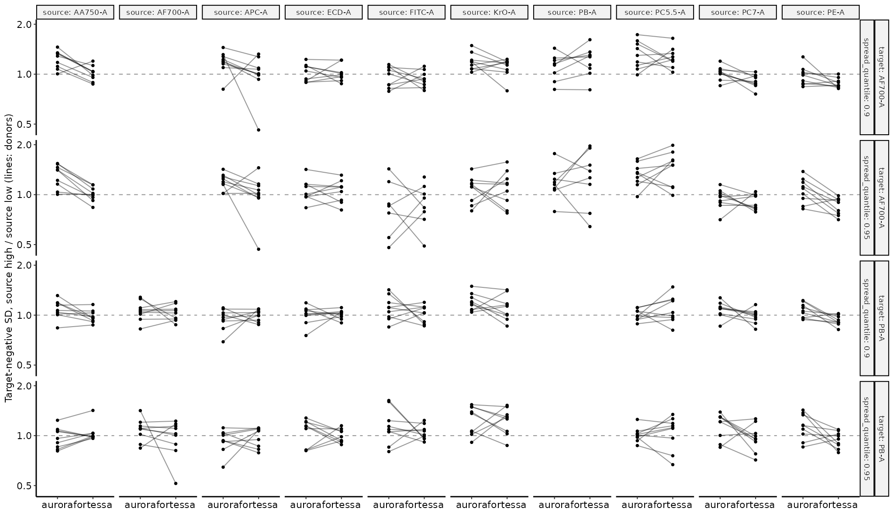

The detector noise floor accounts for PB's wider negative, but only for part
of AF700's. Each donor has an unstained file on both instruments. We gated it
with a box from the same donor's gated panel (5th to 95th percentile of FSC-A,
SSC-A and FSC-H/FSC-A), mapped it with the authors' CD3 map, and took the
robust SD on the same scale as the panel negatives. For PB, unstained cells
widen on the Fortessa as much as the panel negative does (unstained ratio over
panel ratio 1.23, range 0.95 to 1.49 over 9 donors). For AF700 they widen 2.9
times, about as much as FITC, APC and PB, against 5.4 times for the panel
negative (ratio 0.55, range 0.45 to 0.63). In absolute terms, the Fortessa AF700
unstained SD is 0.09 against 0.53 for the panel negative (medians; table
fallback: absolute SDs are not plotted, see `ratios.csv` in the run folder). So
most of the AF700 widening comes with the stain, not the empty detector; this
test does not say which part of the stain. PE and PC7 unstained ratios (7.7 and
5.7) exceed their panel ratios because the Aurora unstained SDs on those
channels are near zero (0.005 and 0.003), so those ratios mean little.

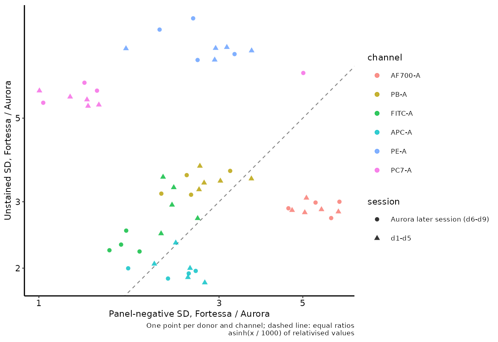

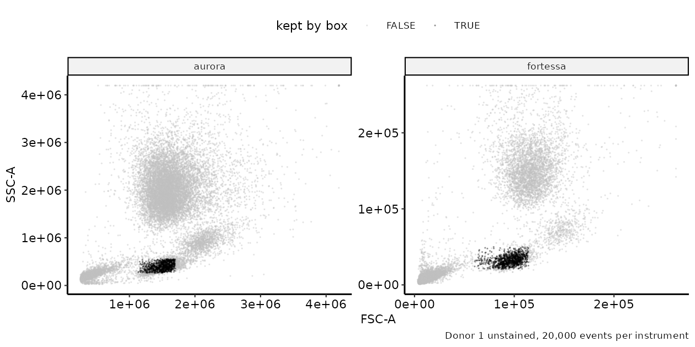

The CD3 single stains do not find the rest of the AF700 widening either. We
gated them with the same box and split CD3- from CD3+ cells by k-means as in
the reproduction above. In the CD3-AF700 stain, CD3- cells carry the AF700
reagent and no other dye. On the Fortessa their AF700 SD is 0.13 (0.12 to
0.20), against 0.09 unstained and 0.53 for the panel negative, so the reagent
alone adds little. Each other single stain gives that dye's spread into AF700
as the AF700 SD in CD3+ over CD3- cells. PC5.5, APC, AA750, ECD and PC7 spread
into AF700, but not more on the Fortessa than on the Aurora: the Fortessa ratio
is higher only for APC (5.9 against 4.3) and lower for PC5.5 (6.3 against
16.9), ECD and PC7. So the widening needs the full panel. Untested candidates
are CD8-dim cells that the Fortessa no longer separates from the negative, the
sum of several dyes' spread, and background of the CD8 reagent, which the CD3
controls do not carry.

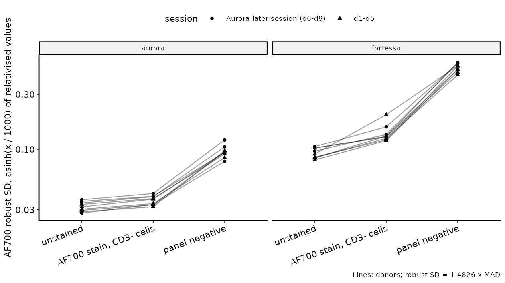

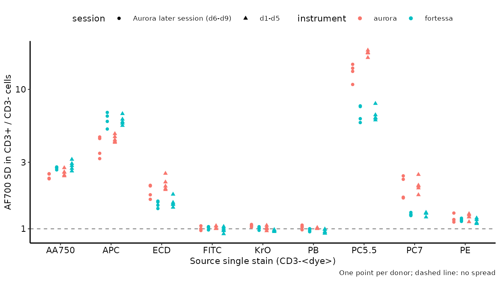

CD8-dim cells do not cause it either: on the Fortessa, the truly CD8-negative
cells are wide themselves. The authors' panel files hold CD3+ cells only, so we
split them by k-means on CD4. CD4+ T cells carry no CD8. Their AF700 SD is 0.51
(0.45 to 0.57) on the Fortessa, as wide as the panel negative (0.53), against
0.094 on the Aurora. On the Fortessa their AF700 also sits higher and is broad,
while on the Aurora it is a narrow peak at 0. The CD4- T cells mix CD8+ and
double-negative cells, so their SD is not a negative's. A wide and shifted
negative in CD4+ T cells fits APC (CD4) to AF700 under-compensation on the
Fortessa, or spread from CD4-APC and CD3-AA750 together; this test does not
separate the two.

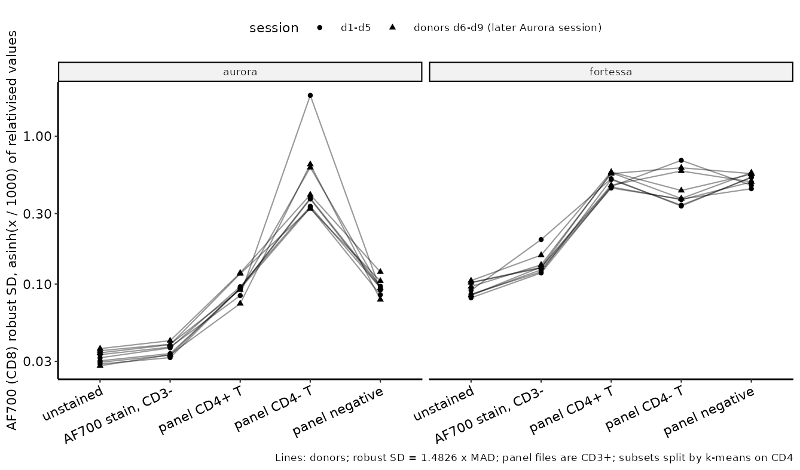

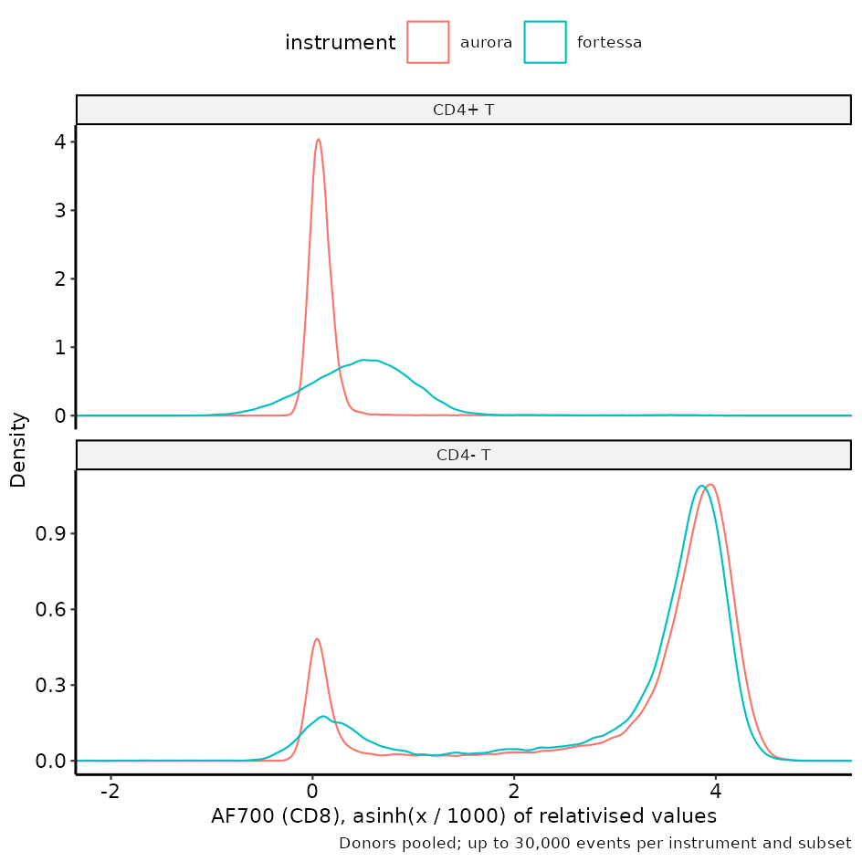

APC is under-compensated into AF700 on the Fortessa, which fits most of the
shift but not the width. In the CD3-APC single stain, CD3+ cells sit 1374
relativised AF700 units (1169 to 1678) above CD3- cells on the Fortessa,
against -142 on the Aurora; AA750 leaves 193 against 88. At the CD4+ T cells'
APC level (median about 2960 units on both instruments) that error predicts an
AF700 offset of about 407 units on the Fortessa, against an observed median of
536 (correlation over donors 0.98; table fallback: one check over 9 donors, in
`single_shift.csv` and the panel files, not plotted). Inside the CD4+ T cells,
AF700 rises only slightly with APC and AA750 (Huber slopes 0.026 and 0.017 on
the Fortessa), because CD4 varies little there, and removing that fit does not
narrow AF700 (SD 0.51 before, 0.54 after). So the wider negative still needs
another cause; APC's spread into AF700 in the single stains is a candidate,
not tested at the panel's CD4 level.

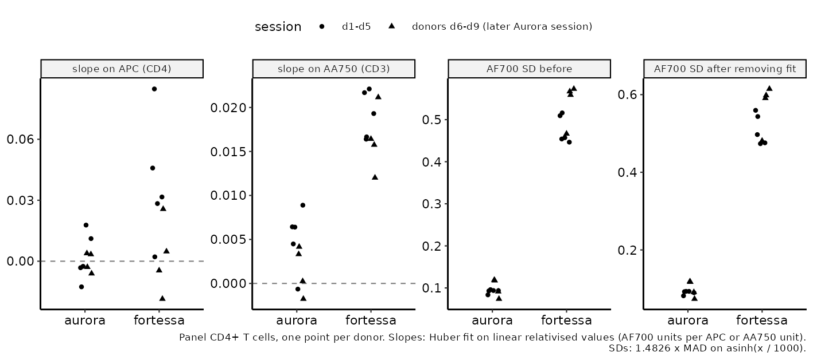

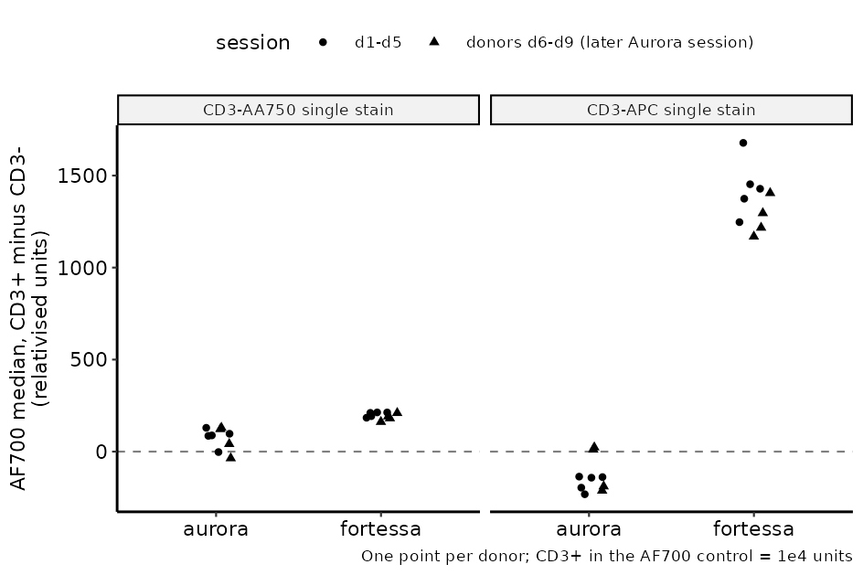

The spread check finds real spread when it is present. Spread injected into
25% of real Aurora files (5 seeds) is found by `spread_z` at AUROC 0.98 with
quantile 0.95 when the added noise equals the target's negative SD at the
source's 90th percentile, and at 0.76 when it is half that. `neg_sd_z` (0.61
to 0.72) and `spill_corr_z` (0.45 to 0.48) miss it.

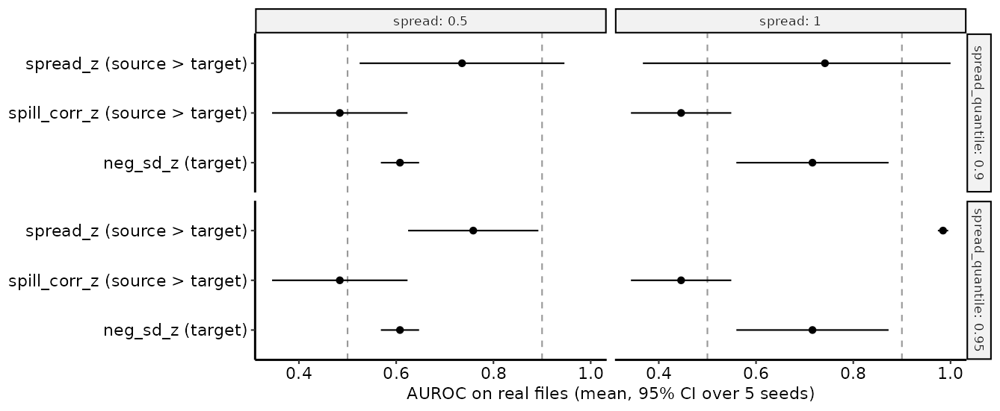

`separation` flags a CD3 control whose split cannot be trusted. On the
Fortessa, the KrO-A control's CD3- and CD3+ sides overlap (separation 1.13 to
1.21; all other channels 2.2 to 3.2). That channel is the only one where our M
misses the authors' (|log ratio| up to 0.28), and the miss shows as a KrO
residual in the instrument test above (eta2 0.52 ours, 0.03 authors).


The header audit sees the instrument too. Against donor 1's Aurora file, every
Fortessa file differs on `$CYT` (LSRII), `$PnR` (262144 against 4194304) and
`$PnV` on all 15 channels. It also finds that Aurora donors 6 to 9 came from a
later session: their `$DATE` and some detector voltages differ.


A batch whose marker splits into two modes is found at ±1 SD (`spread_ratio`
0.99) but not at ±0.5 SD (best `pair_emd` 0.78).


## Gating against an expert gate

The Glehr authors' relativised files hold exactly their lymphocyte, singlet,
CD3+ events, so they are a real expert gate. Our per-sample valley gate on CD3
(Silverman bandwidth, peaks at least 5% of the tallest and two bandwidths
apart; user choices) and landmark transfer were scored by per-event F1
against it, inside an approximate scatter box (`06_gate_benchmark.R`).

On FORT (14 samples on a Fortessa, an LX and a Navios) every method scores F1
0.999. On BAD it scores 0.955 to 0.969; there the approximate box caps
precision (1.9 to 5.4% of above-cut events lie outside the authors' gate). On
6 of 9 BAD Fortessa samples the valley rule found one CD3 peak and returned
`NA` with that reason; transferring the gate from the first Fortessa sample
with a cut filled all six (F1 0.965 to 0.969). Across instruments a gate must
be rescaled: Aurora to Fortessa scores 0.31 with a shift only and 0.97 with
`allow_scale`. The failed shift-only gate kept every event in all nine
samples; `kept_share` = 1 shows it, while `kept_share_z` is `NA` (no spread).

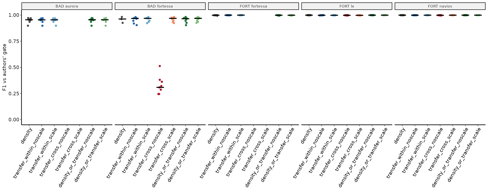

## Eighteen batches of the same four controls

The CytoBatchFlagR data (Zenodo 15388817) hold the same four control samples
(two unstimulated, two stimulated) acquired in 18 batches over two years on
one Aurora. With biology fixed, every batch difference is technical. Scripts:
`experiments/integration/cytobatchflagr/`.

Batch explains 22% (CD8) to 95% (CD14) of the variance of file medians, over
the 26 named markers present in every file. The files are pre-gated CD14-,
so CD14's high value likely reflects shifts in its background rather than in
CD14+ cells (not checked with a figure).


An internal CD3 reference (each file's own CD3 split, no separate controls)
lowers CD3's batch eta2 from 0.73 to 0.43 only. Its split is weaker than with
the Glehr controls (separation median 1.7 to 1.9, lowest 1.02), probably
because no lymphocyte gate exists here. The CD3 gain itself is a diagnostic:
it falls over the two years (`gain_order_rho` -0.52), jumps for all four
samples in one batch (January 2023), and jumps for single samples inside a
batch.


Doublets were injected into 18 of the 72 files (2%, 5% or 10% of events, 5
seeds): an injected event adds a partner's area channels and keeps the larger
height. `area_height_z` on `FSC-A / FSC-H` finds them at AUROC 1.00 from 2%
with quantile 0.99, and from 5% with quantile 0.95 (0.68 at 2%). The SD
checks stay near chance. The files were gated to singlets before upload, so
their own doublet rate is low; real doublets also differ from this ideal sum.

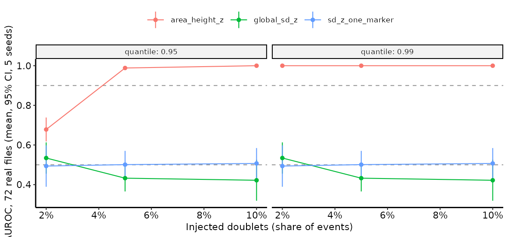

`reference_group` scores each file only against files of the same donor.
On these 72 files it does not lift the four donor-limited faults to the bar.
With it, all markers widened x1.2 scores 0.71 (0.57 without), and 50% of the
largest cluster removed scores 0.71 (0.54). The two-mode split at ±0.5 SD
(0.50), 50% of the smallest cluster (0.48), and the batch split at ±0.5 SD
(0.68, CI about 0.45 to 0.91) stay near chance. Without grouping, every row is
lower here than on the single-batch Aurora files. The likely cause, not
tested: each donor's 18 files come from 18 batches, so batch-to-batch
variation stays inside every group's reference.

A two-way `reference_group` (a data frame of file, donor and batch) removes
both effects by median polish and takes the robust z of the residuals. It
does not help either: no fault reaches the bar, and the best score is 0.68
(50% of the largest cluster). It scores below the one-way form on the two
faults where that form helped (0.61 vs 0.71 at x1.2; 0.68 vs 0.71), and all
confidence intervals overlap. With few files per design, many residuals are
exactly zero, so the MAD shrinks and noise gets large z. The batch split has
no two-way arm, because removing batch removes the effect under test.

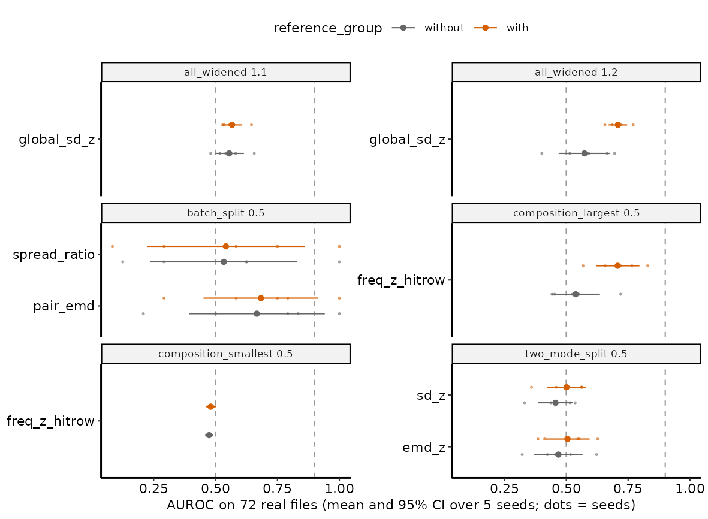

`pair_emd` takes the largest raw EMD over 153 batch pairs, so markers with wide
natural batch spread win whichever batch was hit. `rest_emd_z` scores each
batch by its EMD to all other batches pooled, as a robust z over batches within
the marker. Over 20 seeds it does not find the batch split either: 0.48 at
±0.5 SD and 0.60 at ±1 SD, against 0.50 and 0.52 for `pair_emd` and 0.43 to
0.49 with no fault (`figures/cbf_batch_rest.png`). The 0.68 above came from 5
seeds; with 20, `pair_emd` sits at chance. One batch of four files among 18 is
too small against donor and batch variation here, so the batch split on these
files is a documented limit.

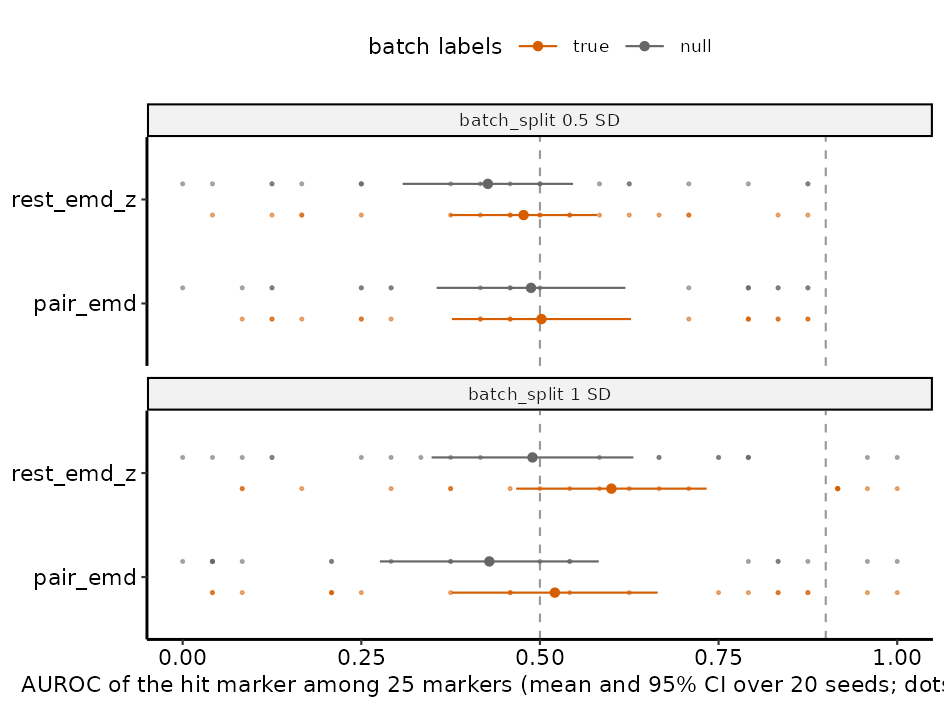

### A fault most files share

`median_z` and `sd_z` compare a file with the cohort, so a fault in most files
moves the cohort centre with it. `sw_signal_reference_fit()` freezes the centre
and scale (median and MAD over files of each channel's file-level median and
SD) from clean files; `sw_signal_reference_save()` and `_load()` keep it with a
digest; `sw_fcs_signal_audit(reference = )` scores new files against it. With
batches 1 to 9 of the CBF files as the reference and a +1 SD shift in 80% of the
files of batches 10 to 18, the frozen z scores 0.93 (CI ±0.06) over 10 seeds,
while the cohort z scores 0.16, because the clean files become the odd ones.
Both nulls score 0.51 (`figures/frozen_reference.png`). AUROC only ranks files:
a real offset between the reference and the new batches moves every frozen z
together and is not tested here, so check the z of known-good files before
using a fixed cutoff.

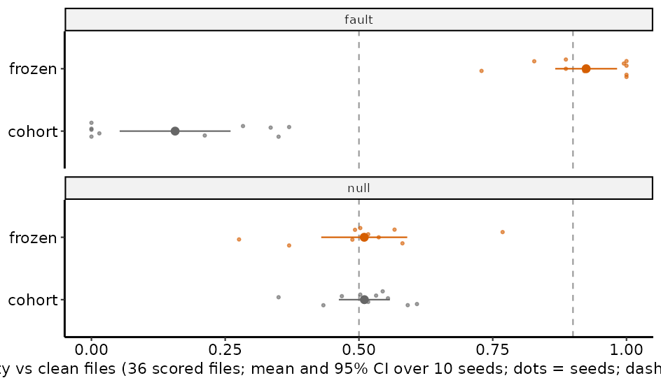

The later batches do carry an offset against the reference, and it shows in the
z of clean files. With no fault, 9.4% of the frozen |z| values (file x marker,
`median_z` and `sd_z`) reach 3 or more, against 5.2% for the cohort z and 4.1%
for the reference files scored against themselves (`figures/frozen_cutoff.png`).
So the offset roughly doubles false flags; real files are heavy-tailed even
without it. The offset does not grow with time: the Spearman correlation of
|z| with acquisition date is 0.12 for `median_z` and 0.03 for `sd_z`, and the
batch medians sit between about 0.5 and 1.3 (`figures/frozen_null_z.png`).
Batch 17 has a few very large values under both arms, so it is an odd batch,
not a reference effect. At the same cutoff, 75% of the faulty files' hit
markers reach |z| 3 under the frozen reference and 1% under the cohort z.
Pick a cutoff from the reference files' own |z| plus a margin, rank per check
and marker as `sw_diagnosis_top()` does, and refit the reference when the
instrument or panel changes; a rolling or bridge-sample reference is not
built yet.

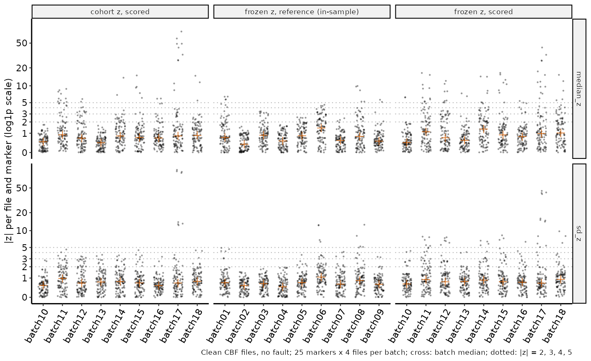

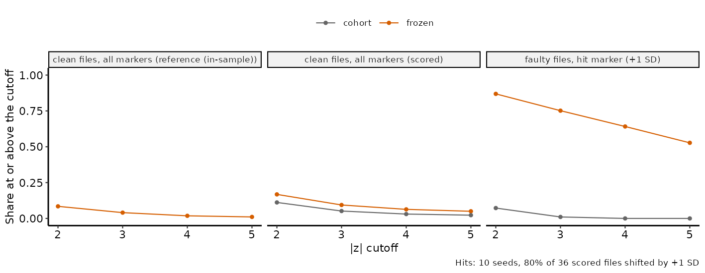

Neither a rolling reference nor a bridge sample removes that excess. Each of
the four controls served in turn as the bridge, with the other three as
reference and scored files (27 each), so the in-sample baseline here is 5.7%
at |z| 3. A rolling reference (the 9 batches before each scored batch) gives
9.7% false flags against 10.9% for the frozen one, but it takes the earlier
faulty batches into its window and finds the 80% fault at AUROC 0.59 (frozen
0.88). Moving each batch so that its bridge file matches the bridge's
batch01-09 median and SD finds the fault better (AUROC 0.93, 93% of hit
markers at |z| 3) but raises false flags to 14.8%, because one file's noise
now moves every file of its batch. Only tcu1 as the bridge lowers them (8.5%),
with AUROC 0.90 and a wide interval (`figures/rolling_bridge_cutoff.png`). The
excess sits in a few batches (11, 14, 15, 17) under every arm
(`figures/rolling_bridge_null_z.png`), so it is a batch property, not a
reference-window one. A bridge that averages several files per batch is
untested.

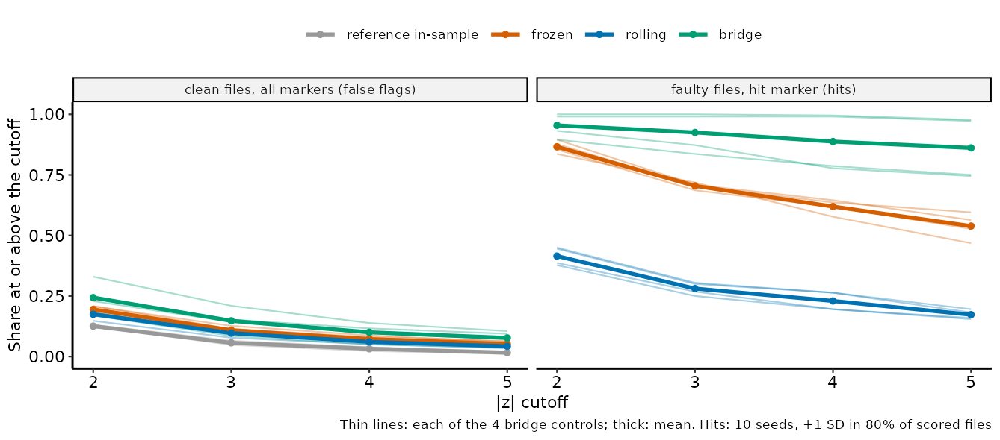

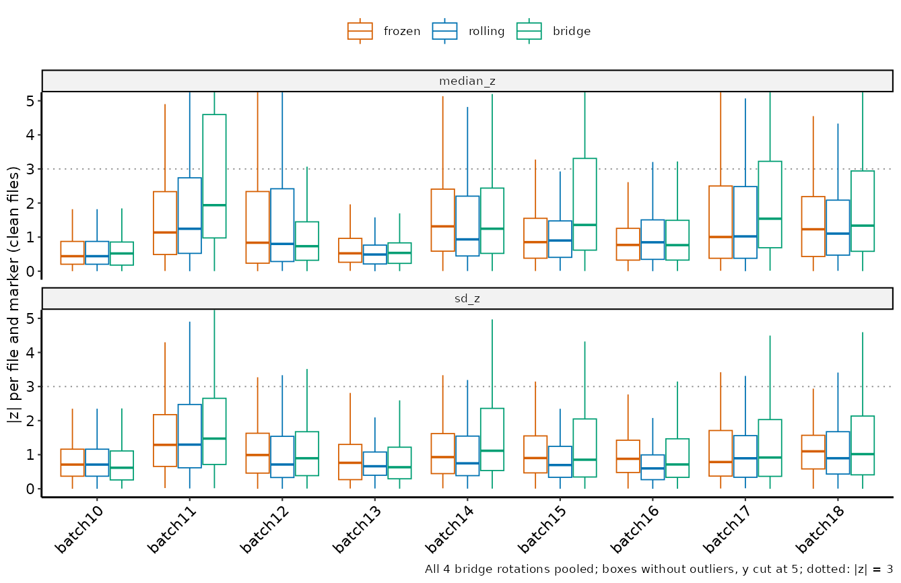

## What the checks cannot see

- The negative checks assume a channel splits into a negative and a positive
  population. In the real Aurora files only 10 of 40 channels did (separation
  of 3 or more); `min_separation` sets the rest to `NA`, so they are not
  checked at all.

These limits come from the benchmarks above and from benchmark v1.

- A change in a population smaller than about 10% of events, or one that falls
  between your `k` clusters, may not be found.
- A one-marker shift below about 0.3 SD, or a stretch below about x1.2, is near
  chance in simulation; on real files the per-marker score needs about 1 SD or
  x1.5 for AUROC 0.95.
- A batch label confounded with biology (all cases in one batch) cannot be
  separated from a batch effect by any score here. Run `sw_design_audit()` first.
- `median_z`, `sd_z` and the forest compare a file with the other files you pass.
  If most files share the same fault, the cohort looks normal. A frozen
  reference (`sw_signal_reference_fit()`) fixes this for `median_z` and `sd_z`
  only.
- A marker split into two modes whose halves sit less than about 1 SD apart
  stays one peak, so no shape score sees it (simulation: `bimodality_z` 0.58,
  dip 0.51; `figures/bimodal_sim_tools.png`).
- One faulty batch of four files among 18 (CBF) is not found at ±0.5 or ±1 SD.

---
