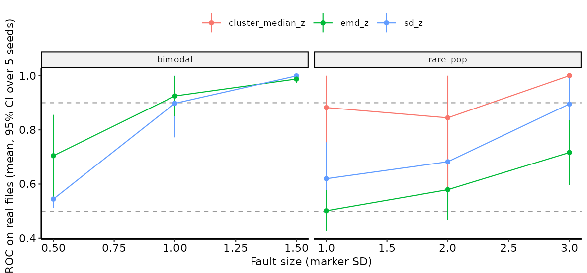
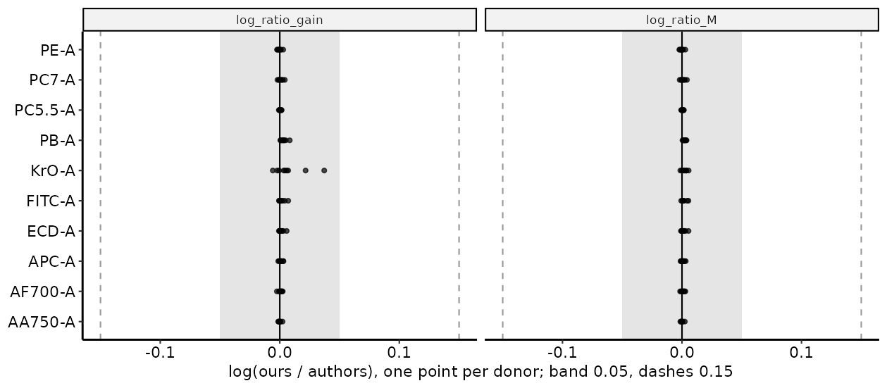
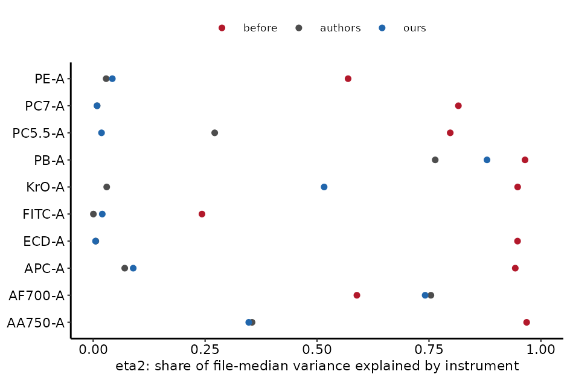
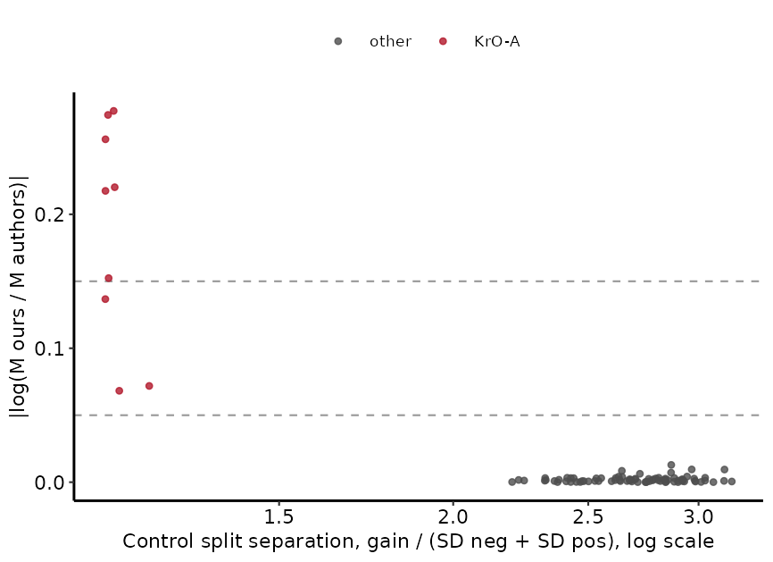
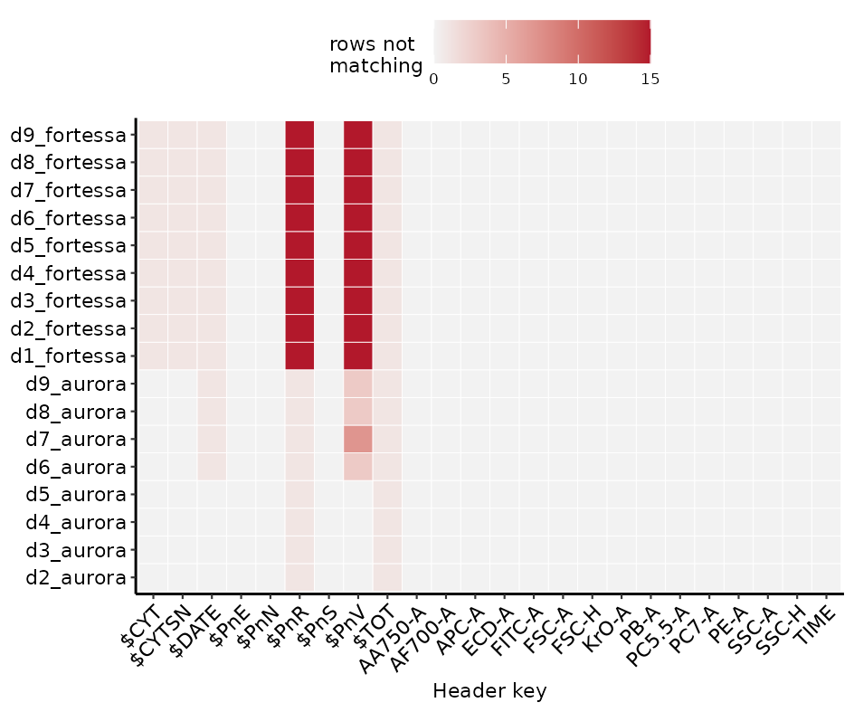
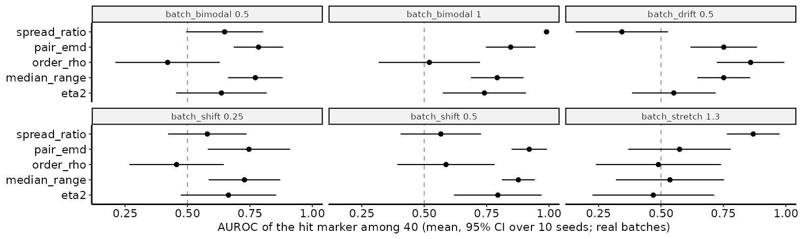
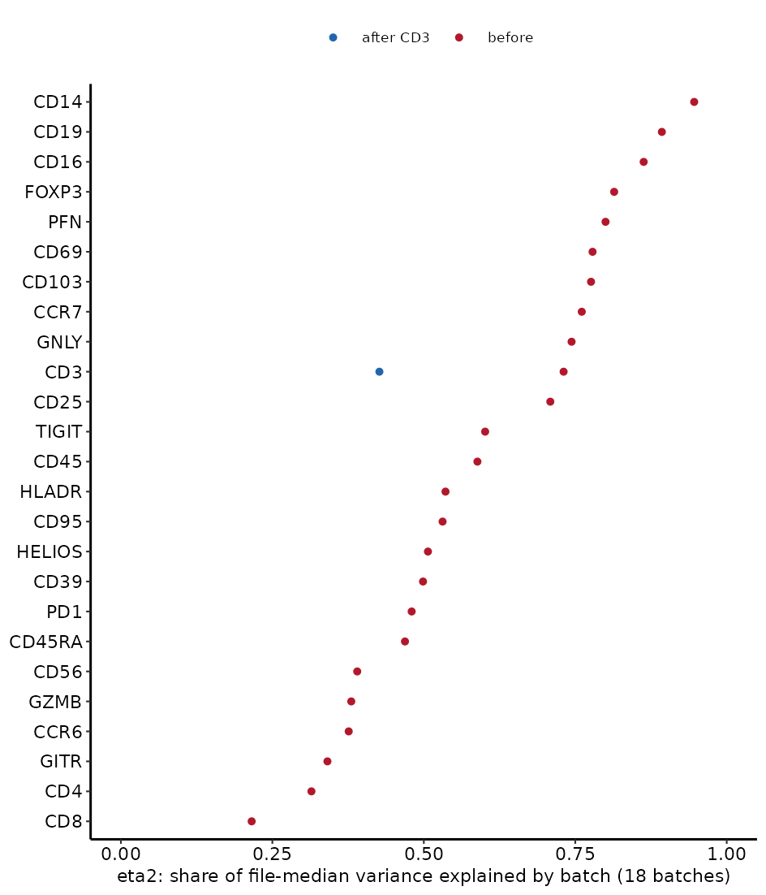
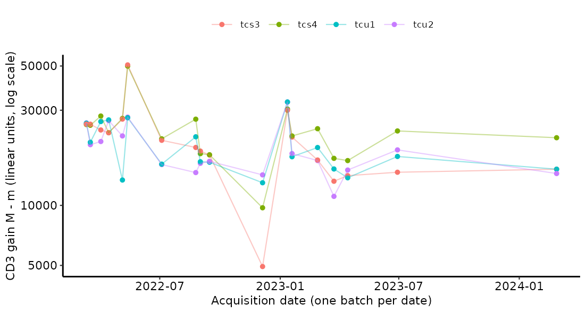

Checks for technical problems in FCS files and batches. Every function returns
numbers. None marks a file or batch as bad, and none has a default for a value
that changes a result (a cutoff, a count of events, a seed, a scale). You choose
those, because a different choice flags different files.

## What each function covers

| Problem | Function | What it reports |
|---|---|---|
| Header differs from a reference (voltage, instrument, channel names) | `sw_fcs_header_audit()` | one row per file and compared item, with a status |
| Saturation, dead channel, non-finite values, negative share | `sw_fcs_signal_audit()` | share or flag per file and channel |
| Event-rate instability, clog, gaps in time | `sw_fcs_signal_audit()` | `rate_cv`, `max_gap` |
| Drift of a marker inside one file | `sw_fcs_signal_audit()` | `time_trend` per channel |
| One marker shifted, stretched or split in a file | `sw_fcs_signal_audit()` | `median_z`, `sd_z` per channel |
| Wrong spillover or unmixing (channel-pair correlation) | `sw_fcs_signal_audit()` | `corr_shift` and the pair |
| Change in a rare population, or in a file's composition | `sw_cluster_scores()` | `freq_z`, `median_z` per cluster |
| File unlike the other files | `sw_anomaly_features()` + `sw_anomaly_flag_outlier()` | forest score per file |
| File unlike a reference set | `sw_anomaly_features()` + `sw_anomaly_flag_novelty()` | log-density per file |
| Batch effect per marker | `sw_batch_scores()` | pairwise EMD, median range, eta2, spread ratio, order drift |
| Signal stability over time | `sw_qc_run()`, `sw_qc_plot()`, `sw_qc_heatmap()` | PeacoQC result, plot, heatmap |
| All of the above in one table | `sw_diagnose()`, `sw_diagnosis_top()` | stacked table; top values per check |
| Browse the result | `sw_qc_app()` | Shiny explorer |
| CytoScan itself | `sw_cytoscan_run()`, `sw_cytotools_header()` | wrappers (GPL, from Suggests) |

## One call

```r
dx <- sw_diagnose(
  data = files, # named list of per-file matrices, already on your analysis scale
  header = NULL,
  signal = list(
    channels = chans, range_max = 4e6, range_min = NULL,
    time_channel = "Time", time_bin = 5
  ),
  anomaly = list(
    channels = chans, features = c("quantile", "emd"), quantile_step = 0.1,
    n_events = 500, seed = 1, scale = "arcsinh, cofactor 6000",
    aggregate_from = "all", agg_size = 5000,
    ntrees = 300, sample_size = 32, ndim = 1
  ),
  batch = list(batch = batch, markers = chans, n_events = 500, seed = 1, order = NULL),
  cluster = list(
    markers = chans, k = 6, n_events = 500, seed = 1, nstart = 3,
    min_cluster_events = 30, reference = NULL
  ),
  relativise = NULL, # or list(model = <sw_relativise_fit() result>, batch = ..., order = ...)
  otd = list(
    markers = chans, n_events = 1000, reference_events = 10000, blur = 0.75,
    seed = 1, max_iter = 500, tol = 1e-5
  ),
  negative = list(channels = chans, n_events = 2000, seed = 1, hyper_k = 4, pairs = "all"),
  gate = NULL
)
sw_diagnosis_top(dx, n = 5)
shiny::runApp(sw_qc_app(dx, n = 15, qc_report = NULL))
```

The numbers above are illustrative. They are not recommended values.

## Coverage at a glance

One row per fault class: the check that finds it best, its AUROC in simulation
and, where tested, on real Aurora files with the fault injected. AUROC ranks
faulty files (or, for batch faults, the hit marker among 40) above clean ones;
0.5 is chance. Sizes are the ones tested, not guarantees. Sections below give
the figures behind each number. Faults marked "not tested" on real files have
no real-file evidence yet.

| Fault class | Best check | Simulation | Real files (injected) |
|---|---|---|---|
| Header / keyword mismatch | `sw_fcs_header_audit()` | exact by construction | real, not injected: all 9 Fortessa files flagged on `$CYT`, `$PnR` and `$PnV` (15 channels); 4 Aurora files flagged on `$PnV` and `$DATE` (a later session) |
| Saturation | `saturation_share` | 1.00 | 1.00 (5% of events at the channel maximum) |
| Dead channel | `zero_variance` | 1.00 | 1.00 |
| Missing or infinite values | `nonfinite_share` | 1.00 | 1.00 (2% of events) |
| Clog / event-rate drop | `rate_cv` | 1.00 | 1.00 (80% drop over 30% of the run) |
| Drift within a file | `time_trend` | 1.00 | 1.00 (1 SD over the run) |
| Debris spike | `corr_shift` | 1.00 | 1.00 (10% of events) |
| Spillover between two channels | `corr_pair_z` (per pair row) | 1.00 (`corr_shift`) | 0.99 at slope 0.3 (`corr_shift` 0.66; the max over pairs 0.62) |
| One-marker shift | `median_z` | 0.99 at 0.5 SD; ~0.6 at 0.2 SD | 0.95 at 1 SD, 0.82 at 0.3 SD (hit marker's row) |
| One-marker stretch | `sd_z` | 1.00 at x1.2; 0.57 at x1.05 | 0.94 at x1.5, 0.80 at x1.3 (hit marker's row) |
| All markers widened | `sd_z` | 1.00 | not tested |
| Split into two modes (one marker) | `emd_z` (anomaly module) | **0.67 (`corr_shift`, weak)** | limit ±1 SD: 0.93 (`sd_z` 0.90); ±1.5 SD ≥ 0.99; ±0.5 SD 0.70, below the bar |
| Change in a rare population | `cluster_median_z` | 1.00 at 20% of events; 0.95 at 10%; 0.49 at 2% | limit +3 SD: 1.00; +1 SD 0.88, +2 SD 0.84 (wide CI; smallest of k = 6 clusters) |
| Composition change | forest, `cluster_freq_z` | 1.00 | not tested |
| Negative population shifted | `neg_median_z` | 1.00 at 0.3 SD | 1.00 at 1 SD, 0.84 at 0.3 SD |
| Negative population widened | `neg_sd_z` | 1.00 at x1.5, 0.96 at x1.2 | 1.00 at x1.5 |
| Hyper-negative events | `hyper_negative_share` | 1.00 at 1% | 1.00 at 3% |
| Angled negative | `neg_corr_z` | 1.00 at slope 0.3 | 0.93 at slope 0.3 |
| Leak into a negative channel | `spill_corr_z` (+ `neg_median_z` if it shifts) | 0.96 at 15% | 0.94 at 15%, 0.68 at 5% |
| Batch shift (one marker) | `pair_emd` | 1.00 | 0.92 at 0.5 SD, 0.75 at 0.25 SD |
| Batch stretch (one marker) | `spread_ratio` / `pair_emd` | 1.00 | 0.87 at x1.3 |
| Batch split into two modes | `spread_ratio` | **0.86 (weak, seeds 0.57 to 1.0)** | 0.99 at ±1 SD; ±0.5 SD best `pair_emd` 0.78, below the bar |
| Drift across a batch | `order_rho` / `pair_emd` | 1.00 | 0.86 at 0.5 SD |
| Instrument offset and gain per batch | `sw_relativise_diagnose()` gain | gain recovered (cor 0.93 to 1.00) | real, not injected: same 9 donors on Aurora and Fortessa; Aurora gains 2.0 to 2.4x the cohort median, Fortessa 0.06 to 0.39x |
| Instrument batch per marker | `eta2` | see batch rows | real: median 0.88 before CD3 relativisation, 0.07 after (AF700, PB, AA750 keep 0.35 to 0.88) |
| Batch effect, biology fixed | `eta2` | see batch rows | real: same 4 controls in 18 batches; eta2 0.22 to 0.95 per marker |
| Instrument gain drift over dates | `gain_order_rho` (relativise) | see relativisation | real: CD3 gain rho -0.52 over two years; one batch-wide jump |
| Weak CD3 anchor in a control | `separation` (relativise) | 1 test case | real: Fortessa KrO-A 1.13 to 1.21, others 2.2 to 3.2; only KrO-A's M is off (up to 0.28 log) |

Real-file numbers come from one Aurora dataset (36 to 144 donor files, 40
markers, OMIQ-transformed). The negative-population numbers cover only the 10
of 40 channels whose mixture split cleanly. The batch numbers sit on top of
real batch differences that are confounded with donor.


## How well each check finds a fault (simulation)

The benchmark in `experiments/benchmarks/07_fault-detection/` injects one fault
class at a time into simulated cohorts (72 files, 8 markers, 12 faulty files or
one faulty batch of 4) and scores each check by AUROC over 10 seeds. Values below
are from simulated data with effect sizes I chose; they say how a check ranks a
fault of that size, not how it will do on your cohort.


- Fifteen of the 17 fault classes have a check with mean AUROC of 0.98 or
  higher (figure: `figures/fault-detection-matrix.png`). One check per class is
  not enough to name a cause: `median_z`, `sd_z` and the cluster checks also
  respond to saturation, drift and dead channels.
- A shift confined to the rarest population (20% of events) is found by
  `cluster_median_z` (AUROC 1.00) and, in this simulation, by `sd_z` (0.99); the
  forest scores 0.63. A composition change is found by `cluster_freq_z` (1.00).
  The cluster checks need `k`, which you choose, and were run with k = 6 here.
- A symmetric split into two modes in a single marker is the weak case:
  best AUROC 0.67 (+/- 0.07) in a file and 0.86 (+/- 0.11, seeds from 0.57 to
  1.0) for a batch. In this mixture the split changes the SD by about 4%, which
  is below the file-to-file jitter.
- With labels shuffled, every check scores 0.50 to 0.54, so the benchmark does
  not reward noise.

## How small a fault can be (simulation)

`experiments/benchmarks/08_detection-limits/` puts one fault of a given size into
12 of 72 simulated files and scores four checks over 6 seeds.


- A one-marker shift is found well at 0.5 SD (`median_z` 0.99) and is near chance
  at 0.2 SD or less. A one-marker stretch is found at x1.2 (`sd_z` 1.00) and not at
  x1.05 (0.57). A 1 SD shift in a rare population is found when it holds 10% of
  events (`cluster_median_z` 0.95), not at 5% (0.59) or 2% (0.49)
  (figure: `figures/detection-limits.png`).
- Changing `k` (3, 6, 12) or the number of faulty files (4, 12, 24) moved these
  limits little; effect size sets them.

## On real files: rank markers, not files

Faults were injected into 36 real Aurora donor files of one batch (40 markers,
OMIQ-transformed; 25% of files faulty, 10 seeds). The z-score of the hit marker
finds a 1 SD shift at AUROC 0.95 and a x1.5 stretch at 0.94. Taking the largest
|z| over all 40 markers per file drops these to 0.74 and 0.69
(figure: `figures/real-injected-marker-level.png`). The hit-marker score knows
which marker was hit, so it is an upper bound. Files differed little in these
data: the SD of file medians was 0.10 of the pooled marker SD.


So `sw_diagnose()` keeps one row per file and marker, and `sw_diagnosis_top()`
ranks within each check and marker. There is no per-file summary score; that
was decided on 2026-11-09.

Two fault classes need a larger fault on real files than in simulation,
because real donors already differ in shape. A marker split into two modes
reaches AUROC 0.90 at ±1 SD (`emd_z` 0.93, `sd_z` 0.90). A shift inside the
smallest of 6 clusters reaches it at +3 SD (`cluster_median_z` 1.00); at +1
and +2 SD it scores 0.88 and 0.84 with wide intervals across seeds.



## Faults that live only in the negative population

`sw_negative_audit()` finds each channel's negative population with a
two-component Gaussian mixture and checks its centre, width, events far below
it, and its correlation with another channel's negative. These symptoms come
from O. Burton's Colibri Cytometry posts on unmixing errors.

In simulation (`experiments/benchmarks/10_negative-faults/`, 12 of 72 files
faulty, 5 seeds), each fault is found by its own check: a 0.3 SD shift of the
negative by `neg_median_z` (AUROC 1.00), a x1.5 widening by `neg_sd_z` (1.00),
3% hyper-negative events by `hyper_negative_share` (1.00), and a 0.3 slope
between two negatives by `neg_corr_z` (1.00). The whole-file checks score 0.45
to 0.65 on the same faults, except `sd_z` at 0.94 for hyper-negatives
(figure: `figures/negative-faults-sim.png`).


On 36 real donor files with the same faults injected
(`experiments/integration/aurora_exvivo/06_negative_real.R`), the matching
check scores 0.93 to 1.00 and the whole-file checks 0.43 to 0.70
(figure: `figures/negative-faults-real.png`). A 0.3 SD shift of the negative is
found at 0.84. These real-file numbers cover only the 10 of 40 channels whose
mixture separation was 3 or more; read `separation` before trusting the
negative checks on a channel.


### Leaks into a negative channel

Tandem breakdown and some dye interactions add signal to a channel that should
be negative, in proportion to a bright channel. `spill_corr` (in
`sw_negative_audit()`) is the Spearman correlation of the two channels inside
events that are positive in the source and negative in the target; pass the
pairs you suspect (for example a tandem and its parent) in `pairs`. On 36 real
donor files with a leak injected that adds no net shift, `spill_corr_z` found a
15% leak at AUROC 0.94 and a 5% leak at 0.68, while every other check stayed at
0.49 to 0.67 (figure: `figures/spill-leak-real.png`). In simulation, a leak that
also shifts the negative is found as well by `neg_median_z` and `corr_shift`.


## Is the clustering stable enough to trust the cluster checks?

`sw_cluster_stability()` reruns k-means with several seeds and subsample sizes
and reports the adjusted Rand index and the share of events that change
cluster. On the real Aurora files (500 events from each of 149 files, 5
seeds), k = 6 gave identical partitions, k = 12 moved a median 12% of events
between seeds (up to 21%), and k = 20 moved 29% (up to 43%)
(figure: `figures/cluster-stability-real.png`). Two runs raised k-means
quick-transfer warnings, so part of that may be non-convergence. Check the
stability at your `k` before reading `cluster_median_z` or `cluster_freq_z`.


## A real instrument batch and its CD3 correction

The Glehr et al. (2026) BAD study stained 9 donors once and acquired each
sample on an Aurora and a Fortessa, with a CD3 single-stain control per
channel. The instrument is then a known batch with identical biology. The
scripts are in `experiments/integration/glehr2026/`.

Our relativisation reproduces the authors' own. Their relativised files are
an exact linear map of the originals (R² = 1 on every donor and channel), so
their m and M can be read back. On the Aurora, our m and M from the controls
match theirs on all 9 donors and 10 channels: median |log M ratio| 0.0011,
worst 0.0056.



`eta2` finds the instrument batch, and relativisation removes most of it. The
instrument explains a median 88% of the variance of file medians before
relativisation. After it, the instrument explains 5% (authors) or 7% (ours).
AF700, PB and AA750 keep 35% to 88%, so on those channels CD3 does not anchor
the two instruments alike.



`separation` flags a CD3 control whose split cannot be trusted. On the
Fortessa, the KrO-A control's CD3- and CD3+ sides overlap (separation 1.13 to
1.21; all other channels 2.2 to 3.2). That channel is the only one where our M
misses the authors' (|log ratio| up to 0.28), and the miss shows as a KrO
residual in the instrument test above (eta2 0.52 ours, 0.03 authors).



The header audit sees the instrument too. Against donor 1's Aurora file, every
Fortessa file differs on `$CYT` (LSRII), `$PnR` (262144 against 4194304) and
`$PnV` on all 15 channels. It also finds that Aurora donors 6 to 9 came from a
later session: their `$DATE` and some detector voltages differ.



A batch whose marker splits into two modes is found at ±1 SD (`spread_ratio`
0.99) but not at ±0.5 SD (best `pair_emd` 0.78).



## Eighteen batches of the same four controls

The CytoBatchFlagR data (Zenodo 15388817) hold the same four control samples
(two unstimulated, two stimulated) acquired in 18 batches over two years on
one Aurora. With biology fixed, every batch difference is technical. Scripts:
`experiments/integration/cytobatchflagr/`.

Batch explains 22% (CD8) to 95% (CD14) of the variance of file medians, over
the 26 named markers present in every file. CD14 is high because the files
are pre-gated CD14-, so its median sits near the background.



An internal CD3 reference (each file's own CD3 split, no separate controls)
lowers CD3's batch eta2 from 0.73 to 0.43 only. Its split is weaker than with
the Glehr controls (separation median 1.7 to 1.9, lowest 1.02), probably
because no lymphocyte gate exists here. The CD3 gain itself is a diagnostic:
it falls over the two years (`gain_order_rho` -0.52), jumps for all four
samples in one batch (January 2023), and jumps for single samples inside a
batch.



## What the checks cannot see

- The negative checks assume a channel splits into a negative and a positive
  population. In the real Aurora files only 10 of 40 channels did (separation
  of 3 or more); on the rest the "negative" is half of one population.

These limits come from the benchmarks above and from benchmark v1.

- A change in a population smaller than about 10% of events, or one that falls
  between your `k` clusters, may not be found.
- A one-marker shift below about 0.3 SD, or a stretch below about x1.2, is near
  chance in simulation; on real files the per-marker score needs about 1 SD or
  x1.5 for AUROC 0.95.
- A batch label confounded with biology (all cases in one batch) cannot be
  separated from a batch effect by any score here. Run `sw_design_audit()` first.
- `median_z`, `sd_z` and the forest compare a file with the other files you pass.
  If most files share the same fault, the cohort looks normal.

---
