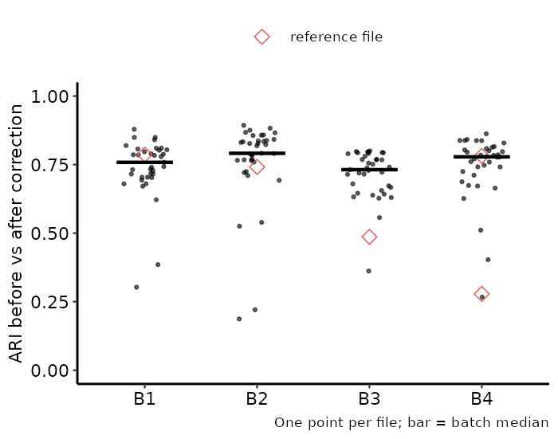
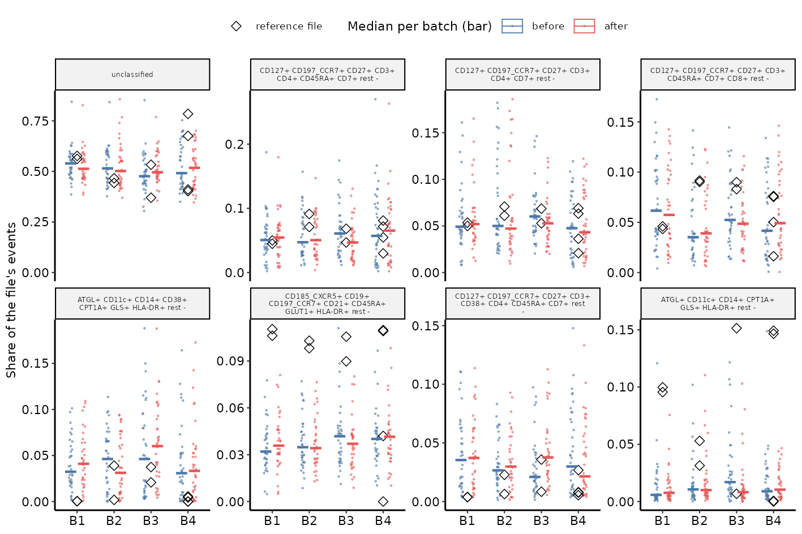

Annotate the same events with FAUST (Greene et al. 2021) before and after batch
correction, then compare the labels. The question is whether correction kept
the biology. The functions return numbers. They do not mark a file or a
phenotype as bad, and none has a default for a value that changes a result.

FAUST is GPL (>= 3). The package never copies its code. It calls `faust::faust()`
from `Suggests` and reads the files FAUST writes.

## Functions

| Step | Function | What it does |
|---|---|---|
| 1 | `sw_faust_gatingset()` | subsample each file, build a `GatingSet` with marker names in `desc` |
| 2 | `sw_faust_run()` | run FAUST into a new project folder; echo every setting and the faust version |
| 3 | `sw_faust_labels()` | read the phenotype of every kept event and the share per file |
| 4 | `sw_faust_compare()` | ARI, shares, marker medians per phenotype, share spread across batches |

## Install

```r
remotes::install_github("RGLab/scamp")
remotes::install_github("RGLab/FAUST")
```

## Use

```r
gs_before <- sw_faust_gatingset(
  data = events_before, # named list of matrices, already arcsinh (cofactor 6000)
  markers = markers, # c(<column name> = <marker name>)
  sample_table = tbl, # sample, batch, donor, role
  n_events = 5000, subsample_seed = 1
)
run_before <- sw_faust_run(
  gs_before, project_path = "faust_before", starting_pop = "root",
  markers = unname(markers), depth_score_threshold = 0.01, selection_quantile = 0.5,
  experimental_unit = "", imputation_hierarchy = "", channel_bounds = "",
  name_occurrence_num = 0, supervised_list = NA, seed = 1, threads = 8,
  density_subsample_threshold = 1e6, density_subsample_size = 1e6,
  density_subsample_iterations = 1, annotation_forest_depth = 3,
  annotations_approved = TRUE,
  draw_histograms = FALSE
)
labels_before <- sw_faust_labels(run_before, events_before)
# repeat for the corrected data with the same settings, then:
cmp <- sw_faust_compare(
  labels_before, labels_after, events_before, events_after,
  batch = batch, role = role, markers = colnames(events_before[[1]]),
  match_by = "marker_state", ari_scope = "file", median_scope = "file"
)
```

The values above are FAUST's own conventions, shown for syntax. They are not
package defaults.

## What to know before you read the result

- **Same events.** Both runs must keep the same rows. Give both data sets the
  same `n_events` and `subsample_seed`. `sw_faust_compare()` stops when the kept
  rows differ.
- **Row order.** The corrected data must keep the row order of the input. Check
  this on your own correction before you trust a median.
- **Experimental unit.** Per-cell labels are read back by row order, which was
  checked only for `experimental_unit = ""`. Other values stop
  `sw_faust_labels()`. A batch unit would also standardise thresholds inside
  each batch and hide part of the effect under test.
- **Phenotype strings.** Labels are FAUST's per-cell tokens, for example
  `CD3~2~2~` (level 2 of 2). A phenotype found on one side only gets `NA` on the
  other side. FAUST may drop a marker by depth score on one side, which changes
  every string; `match_by = "exact"` then shows `NA` and not a wrong match.
  FAUST also orders the markers per run, so the same phenotype can get a
  different string. `match_by = "marker_state"` sorts the tokens by marker
  before matching; a changed marker set still gives `NA`.
- **Unclassified bin.** The all-zero label stays in the table as its own phenotype.
- **Batch and donor.** If donors nest in batches, a phenotype that differs by
  batch among donor files is confounded with donor. `prop_by_batch_*` is split by
  `role` so reference files read apart from donor files.
- **Review step.** `annotations_approved = FALSE` stops after the thresholds. Check
  `plotData/scoreLines.*`, then run again in a new folder.
- **Forest depth.** `annotation_forest_depth` passes `annotationForestDepth`; the runs here use 3, the FAUST default (user decision G11).

## Output table

`sw_faust_compare()` returns one long tibble: `module` (`"faust"`), `subject`,
`check`, `item`, `phenotype`, `value`, `text`.

| `check` | `subject` | `item` | `value` |
|---|---|---|---|
| `ari` | file or `pooled` | | adjusted Rand index between the two label sets |
| `prop_before`, `prop_after`, `prop_diff` | file | phenotype | share of the file's events |
| `median_before`, `median_after`, `median_diff` | file or `pooled` | marker | median over the phenotype's events |
| `prop_by_batch_before`, `prop_by_batch_after` | role | phenotype | range over batches of the per-batch median share |

## Result on the Aurora ex vivo files

149 files (4 batches, 4 reference files), 5000 events each, 37 markers, cyCombine
with `norm_method = "rank"`. FAUST ran once on the data before correction and
once after, with the same settings. It found 43 phenotypes before and 48 after;
about 52% of events stay unclassified both times. Run:
`experiments/integration/aurora_exvivo/15_faust_before_after.R`.

Correction kept most labels. The per-file ARI between the two label sets has a
median of 0.77 (range 0.19 to 0.89), and the batch medians lie between 0.73 and
0.79. Two reference files score low: 0.49 in B3 and 0.28 in B4.



The two FAUST runs list the same markers in a different order, so
`match_by = "exact"` matched only the unclassified bin. With
`match_by = "marker_state"` all 43 phenotypes found before correction match one
found after. In the eight largest phenotypes, the donor median share per batch
moves by at most 2.7 percentage points (unclassified, B1); the median move is
0.4 points. The reference files sit apart from the
donors in several phenotypes.


